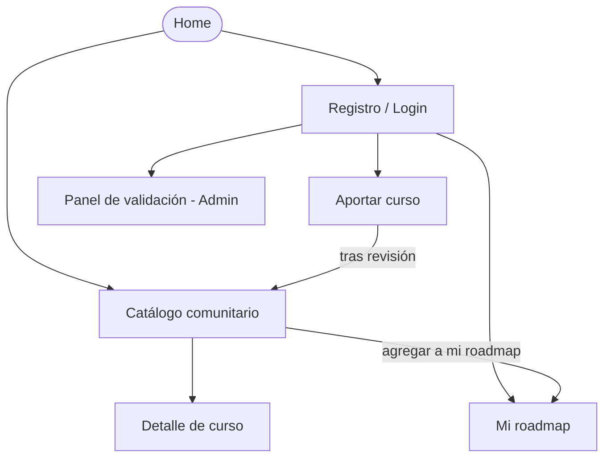

# APPFlow — Mapa del sitio y flujos de usuario — Roadmap de Cursos UTN

> **Qué es:** el esqueleto de navegación. Define el Sitemap, las rutas exactas, la ficha técnica de cada pantalla y los flujos de usuario extremo a extremo.

## 1. Sitemap

## 2. Rutas

| Ruta | Pantalla | Requiere login | Notas |
|------|----------|----------------|-------|
| `/` | Home | No | Landing page descriptiva y CTA al catálogo. |
| `/catalogo` | Catálogo comunitario | No | Listado paginado con filtros. |
| `/catalogo/:id` | Detalle de curso | No | Ficha técnica completa del curso. |
| `/login` | Ingreso | No | Si el usuario ya tiene sesión, redirige a `/roadmap`. |
| `/registro` | Registro | No | Crea la cuenta y redirige a `/login`. |
| `/roadmap` | Mi roadmap | Sí | Lista personal de cursos guardados. |
| `/aportar` | Formulario de aporte | Sí | Formulario para cargar URLs externas. |
| `/admin/validar` | Panel de validación | Sí (Admin) | Exclusivo para usuarios con rol `admin`. |

## 3. Fichas de pantalla

### Pantalla: Catálogo comunitario (`/catalogo`)
- **Objetivo:** Descubrir cursos gratuitos validados.
- **Componentes UX/UI:** Header (drawer en mobile), select de categorías, input de búsqueda, grid de tarjetas de curso, paginador inferior.
- **Estados:** `loading` (skeleton en tarjetas) · `ok` (listado) · `empty` (ilustración "No hay cursos en esta búsqueda").
- **APIs que consume:** `GET /api/v1/cursos?page=...&categoria=...`
- **Navegación:** Click en tarjeta lleva a `/catalogo/:id`.

### Pantalla: Mi roadmap (`/roadmap`)
- **Objetivo:** Visualizar y organizar el plan de estudio personal.
- **Componentes UX/UI:** Header, lista estructurada de los cursos seleccionados, botones de eliminar.
- **Estados:** `empty` ("Aún no agregaste cursos, explorá el catálogo").
- **APIs que consume:** `GET /api/v1/roadmaps/me`
- **Navegación:** Botón primario hacia `/catalogo` si está vacío.

### Pantalla: Aportar curso (`/aportar`)
- **Objetivo:** Enviar un curso nuevo a la cola de revisión.
- **Componentes UX/UI:** Formulario de 1 columna. Inputs para URL, título, tema. Select de categoría. Checkboxes para certificado/examen. Radio button obligatorio para "Yo tomé este curso".
- **Estados:** Validaciones en línea por campo (errores en rojo) · `submitting` (botón loading).
- **APIs que consume:** `POST /api/v1/cursos/aportes`

### Pantalla: Panel de validación (`/admin/validar`)
- **Objetivo:** Aprobar o rechazar aportes pendientes.
- **Componentes UX/UI:** Tabla densa de revisión con acciones directas (✓ o ✗).

## 4. Flujos de usuario principales

### Flujo 1 — Descubrir un curso y agregarlo a mi roadmap
1. El usuario (logueado) navega a `/catalogo`.
2. Filtra por categoría "Programación". El frontend hace fetch a la API y renderiza resultados.
3. Hace click en "Agregar a mi roadmap" sobre una tarjeta.
4. Se ejecuta `POST /api/v1/roadmaps/items` con el ID del curso.
5. Toast de éxito verde: "Curso agregado a tu roadmap".
6. Error alternativo: Si ya lo tenía, toast de info "Este curso ya está en tu plan".

### Flujo 2 — Aportar un curso al catálogo
1. Usuario va a `/aportar`.
2. Completa el formulario con URL, título, checkboxes y la declaración requerida.
3. Intenta enviar con un campo vacío → el input se pinta con `--color-error` y no avanza.
4. Completa correctamente y presiona "Enviar aporte".
5. Backend responde 201 (estado `en_revision`).
6. Toast verde de éxito y redirección a `/catalogo`.

### Flujo 3 — Validación (Admin)
1. Administrador ingresa a `/admin/validar`.
2. Visualiza tabla con aportes pendientes.
3. Verifica la URL. Hace click en "Aprobar".
4. `PATCH /api/v1/cursos/:id/estado` con status `publicado`.
5. El curso desaparece de la tabla y ya es visible en el catálogo público.

## 5. Estados globales de la app

| Situación | Comportamiento |
|-----------|----------------|
| Sin sesión en ruta protegida | Interceptado por el router del frontend, redirección automática a `/login`. |
| Token JWT expirado | Llamada API devuelve 401, el cliente borra estado y redirige a `/login` con toast explicativo. |
| Error de red (500) | Toast global rojo: "Ocurrió un error en el servidor. Intentá de nuevo." |