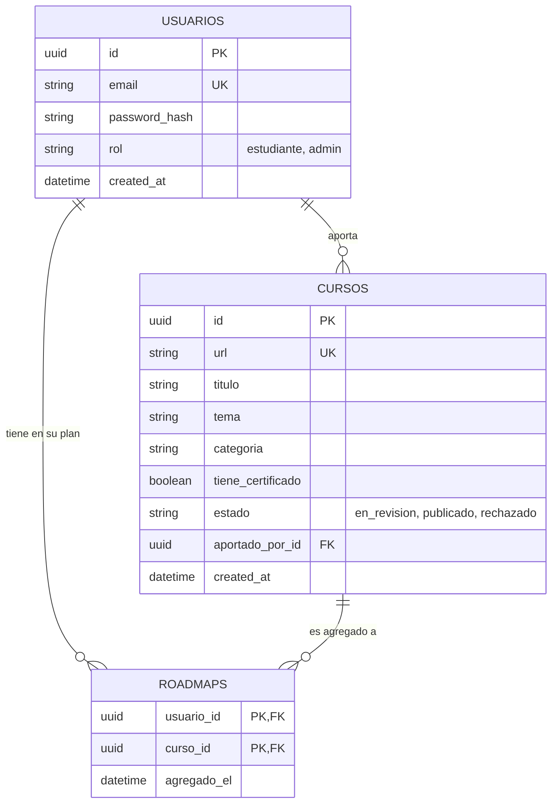

# BackendSchema — Diagrama de BD y API — Roadmap de Cursos UTN

> **Qué es:** la estructura de datos relacional y el contrato de los endpoints (API REST) que consumirá el frontend.

## 1. Diagrama de Entidad-Relación (ERD)

## 2. Diccionario de Datos

### Tabla: `usuarios`
Almacena las credenciales y el rol de acceso.
- `id` (UUID): Clave primaria.
- `email` (VARCHAR): Único, usado para el login.
- `password_hash` (VARCHAR): Hash generado con bcrypt (Argon2 es alternativo viable).
- `rol` (VARCHAR): Enum `['estudiante', 'admin']`. Default: `estudiante`.

### Tabla: `cursos`
El catálogo base de todos los aportes.
- `id` (UUID): Clave primaria.
- `url` (VARCHAR): Único. Evita que dos usuarios aporten exactamente el mismo link.
- `titulo`, `tema`, `categoria` (VARCHAR): Metadatos básicos.
- `estado` (VARCHAR): Enum `['en_revision', 'publicado', 'rechazado']`.
- `aportado_por_id` (UUID): FK a `usuarios.id`. Indica quién lo subió.

### Tabla: `roadmaps` (Relación M:N)
Tabla intermedia que mapea qué cursos eligió cada usuario para su plan.
- `usuario_id` (UUID): FK a `usuarios.id`.
- `curso_id` (UUID): FK a `cursos.id`.
- `agregado_el` (TIMESTAMP): Permite ordenar cronológicamente el roadmap.

## 3. Contrato de API (Endpoints principales)

| Método | Endpoint | Body (Request) | Response (Éxito) | Auth | Notas |
|--------|----------|----------------|------------------|------|-------|
| POST | `/api/v1/auth/registro` | `{email, password}` | `201 Created` | No | Crea usuario `estudiante`. |
| POST | `/api/v1/auth/login` | `{email, password}` | `200 OK` (+ Cookie) | No | Devuelve token JWT en cookie HttpOnly. |
| GET | `/api/v1/cursos` | - | `200 OK` (Paginado) | No | Acepta `?page=1&categoria=X`. Trae solo estado `publicado`. |
| POST | `/api/v1/cursos/aportes` | `{url, titulo, tema...}` | `201 Created` | Sí | Crea curso con estado `en_revision`. |
| PATCH | `/api/v1/cursos/:id/estado` | `{estado: "publicado"}` | `200 OK` | Admin | Validación de un aporte. |
| GET | `/api/v1/roadmaps/me` | - | `200 OK` (Array) | Sí | Devuelve el catálogo del usuario logueado. |
| POST | `/api/v1/roadmaps/items` | `{curso_id}` | `201 Created` | Sí | Agrega un curso al roadmap personal. |
| DELETE | `/api/v1/roadmaps/items/:id`| - | `204 No Content` | Sí | Remueve un curso del roadmap. |